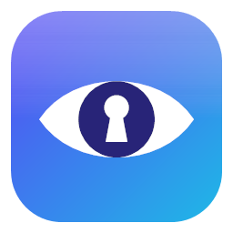

<div align="center">



# SeePass

**Your passwords, on your disk, under your key. Made by Akulav.**

No cloud. No accounts. No telemetry. It never touches the network. One file per system that installs and updates itself.

[](https://github.com/Akulav/offline-password-manager/releases/latest)
[](https://github.com/Akulav/offline-password-manager/releases)
[](https://github.com/Akulav/offline-password-manager/actions/workflows/build.yml)


### [⬇ Download the latest release](https://github.com/Akulav/offline-password-manager/releases/latest)


</div>

---

## ⬇️ Download

One file per system. The same file installs SeePass the first time and updates it later: to update, just run the newer
one.

| Platform | File | Notes |
| :-- | :-- | :-- |
| 🪟 **Windows 10 / 11** (x64) | [`SeePass-setup.exe`](https://github.com/Akulav/offline-password-manager/releases/latest/download/SeePass-setup.exe) | Asks where to install. No admin rights needed. |
| 🐧 **Linux** (x64) | [`SeePass-linux-x64`](https://github.com/Akulav/offline-password-manager/releases/latest/download/SeePass-linux-x64) | glibc 2.35+ (Ubuntu 22.04 or newer), X11 or Wayland |
| 🍎 **macOS** (Apple Silicon) | [`SeePass-macos-arm64`](https://github.com/Akulav/offline-password-manager/releases/latest/download/SeePass-macos-arm64) | macOS 12+ |

Every release also ships `SHA256SUMS.txt` so you can verify your download (`sha256sum -c SHA256SUMS.txt --ignore-missing`).

## ✨ Features

<table>
<tr>
<td width="50%" valign="top">

### 🔐 Strong, modern crypto
- **Argon2id** key derivation and **XChaCha20-Poly1305** authenticated encryption.
- Every byte of the file, header included, is tamper-evident. [Details](docs/security.md).
- **Auto-lock** after inactivity; locking wipes the decrypted data and key from memory.

</td>
<td width="50%" valign="top">

### 🗂️ Everything you'd expect
- Add, edit, search, sort and delete entries, favorites pinned to the top, 10-second undo for deletes.
- **Password generator** with an entropy readout and a zxcvbn **strength meter**.
- Warns about **reused** passwords and ones unchanged for over a year.

</td>
</tr>
<tr>
<td width="50%" valign="top">

### 📋 Safe by default
- Copied secrets are wiped after 20 s and kept out of Windows clipboard history and cloud sync.
- **Backups:** atomic saves, an automatic previous-version `.bak`, and encrypted backup export / merge.
- Imports SeePass 7 vaults (`C:\PasswordManager` or its `data.zip`).

</td>
<td width="50%" valign="top">

### 📁 One folder, yours
- **You choose the install folder** once; SeePass and your encrypted vault live there.
- A newer download updates the installed copy in place, in the same folder.
- A single native Rust binary. Light and dark themes, full keyboard navigation.

</td>
</tr>
</table>

## 🚀 Getting started

### Windows
1. Download **`SeePass-setup.exe`** and run it.
2. Pick the install folder (default `%LOCALAPPDATA%\Programs\SeePass`, any folder you can write to works,
   e.g. `D:\Apps\SeePass`). It adds Start-menu and (optional) Desktop shortcuts and an entry in *Settings → Apps*.
3. To update, run a newer `SeePass-setup.exe`: it installs into the same folder without asking.

Uninstall from *Settings → Apps*. The uninstaller asks whether to delete your vault (default: keep it).

### Linux
```bash
chmod +x SeePass-linux-x64
./SeePass-linux-x64
```
It asks for an install folder (default `~/.local/share/SeePass`), copies itself there and adds an app-menu entry with
icon and a `seepass` terminal command. *Just run it* skips installing. Running a newer download later offers to update
the installed copy in its folder. Uninstall with `seepass --uninstall`.

### macOS (Apple Silicon)
```bash
chmod +x SeePass-macos-arm64
xattr -d com.apple.quarantine SeePass-macos-arm64
./SeePass-macos-arm64
```
It asks for an install folder (default `~/Applications/SeePass`) and creates `SeePass.app` there.

> 💡 Want it portable, e.g. on a USB stick? Put an empty `portable.txt` next to the program (or start it with
> `--portable`): it then keeps the vault next to itself and never offers to install.

### Using SeePass
1. **First launch:** choose a master password. It cannot be recovered, so write it down somewhere safe.
2. **Add entries** with **New** (Ctrl+N). The 🎲 button fills in a generated password.
3. **Copy** a username or password from an entry's page. The clipboard clears itself.
4. **Lock** (Ctrl+L) when you step away, or let auto-lock do it.

| Keys | Action | | Keys | Action |
| :-- | :-- | :-- | :-- | :-- |
| Ctrl+N | New entry | | Ctrl+C | Copy password of selected entry |
| Ctrl+F | Search (Esc clears) | | Ctrl+B | Copy username |
| ↑ / ↓ | Move through the list | | S | Toggle favorite |
| E or Enter | Edit selected entry | | Del | Delete (with undo) |
| Ctrl+S | Save while editing | | Ctrl+L | Lock |

**Coming from SeePass 7?** Create your new vault, then **Settings → Import from SeePass 7**. The old files are only
read, never modified. See [docs/migrating-from-7.md](docs/migrating-from-7.md).

## 📁 Where your data lives

**In the install folder you chose**, next to the program. Nothing goes to `%APPDATA%`, `~/.local/share` or
`~/Library/Application Support`. The folder is remembered (Windows: by the setup; Linux/macOS: in
`~/.config/seepass/install-dir` or `~/Library/Application Support/seepass/install-dir`), so updates keep everything in
place. A vault from SeePass 8.0 / 8.1 (`%APPDATA%\SeePass\data`, `~/.local/share/seepass`, …) is moved in on the first
start of the installed copy, also when the install folder is on another drive. (A copy that is *not* installed keeps
opening that old vault until you install it.)

| Path | Contents |
| :-- | :-- |
| `vault.seepass` | your encrypted vault |
| `vault.seepass.bak` | the previous version of it |
| `settings.json` | theme, auto-lock and clipboard settings (nothing secret) |
| `.seepass-install` | marks the install folder (holds the installed version) |

`seepass --vault <file>` opens a different vault; `SEEPASS_HOME=<folder>` moves the vault and settings to one folder.

## 🖥️ Command line

| Flag | Meaning |
| :-- | :-- |
| `[--vault] <file>` | Open a specific vault file |
| `--here` | Run without offering to install (Linux/macOS) |
| `--portable` | Keep the vault next to the program, never install |
| `--uninstall` | Remove the installed app (Windows: starts the uninstaller) |

<details>
<summary><b>🛠️ For maintainers: releases and building</b></summary>

### Publishing a release

Releases are fully automated by [`.github/workflows/build.yml`](.github/workflows/build.yml):

1. Bump `version` in `Cargo.toml` and add its section to [`CHANGELOG.md`](CHANGELOG.md).
2. Push to `main`.
3. If no release with that version exists, CI checks formatting and Clippy, tests and builds all three systems, tags
   the commit `vX.Y.Z` and publishes a GitHub release with exactly three programs, `SeePass-setup.exe`,
   `SeePass-linux-x64` and `SeePass-macos-arm64`, plus `SHA256SUMS.txt`. The notes come from the changelog.

SeePass never checks for updates by itself (it never touches the network): running a newer setup or binary updates the
installed copy in its folder. See [docs/releasing.md](docs/releasing.md).

### Building from source

You need a stable [Rust toolchain](https://rustup.rs). On Linux also the GTK/X11 development packages:

```bash
sudo apt-get install libgtk-3-dev libxcb-render0-dev libxcb-shape0-dev libxcb-xfixes0-dev libxkbcommon-dev libssl-dev
```

```bash
cargo run --release
cargo test
```

The Windows setup needs [Inno Setup 6](https://jrsoftware.org/isinfo.php):

```bash
iscc /DAppVersion=8.2.0 /DSourceExe=%CD%\target\release\seepass.exe installer\seepass.iss
```

To try the UI with fake data and leave your real vault alone:

```bash
SEEPASS_HOME=./demo cargo run --example demo_vault
SEEPASS_HOME=./demo SEEPASS_DEV_PASSWORD=demo-vault-correct-horse-battery cargo run
```

(`SEEPASS_DEV_PASSWORD` auto-unlocks **debug builds only**.) Screenshots come from the headless UI tests:
`SEEPASS_UI_SNAPSHOTS=target/ui cargo test --bin seepass -- --test-threads=1`. `cargo build --no-default-features`
leaves out the SeePass 7 importer and its bundled SQLite. Debug builds never offer to install themselves.

### Documentation

- [Security design & threat model](docs/security.md)
- [Architecture](docs/architecture.md)
- [Releasing](docs/releasing.md)
- [Migrating from SeePass 7](docs/migrating-from-7.md)

</details>

## 🙏 Credits

Built with [egui](https://github.com/emilk/egui), RustCrypto's Argon2 and ChaCha20-Poly1305, and zxcvbn. The SeePass
name and icon are part of the project.

---

<div align="center">

**Made with ❤️ by [Akulav](https://github.com/Akulav)**

<sub>© 2026 Akulav. Source-available under the <a href="LICENSE">Akulav Source-Available License</a>.</sub>

</div>
