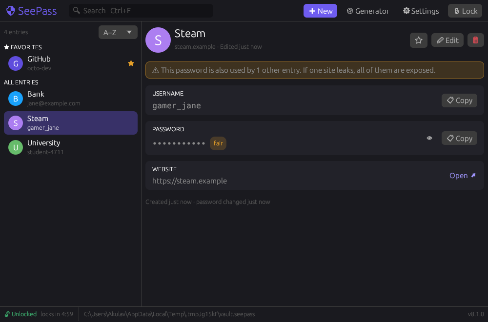
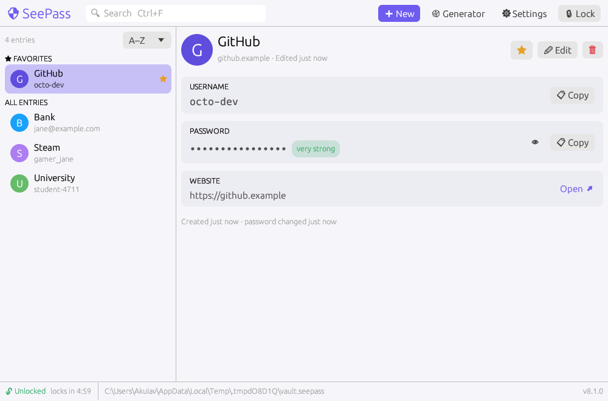
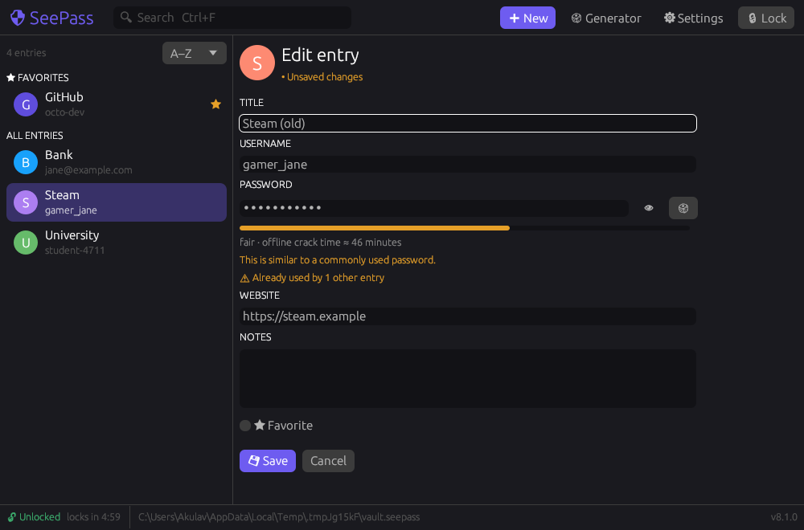
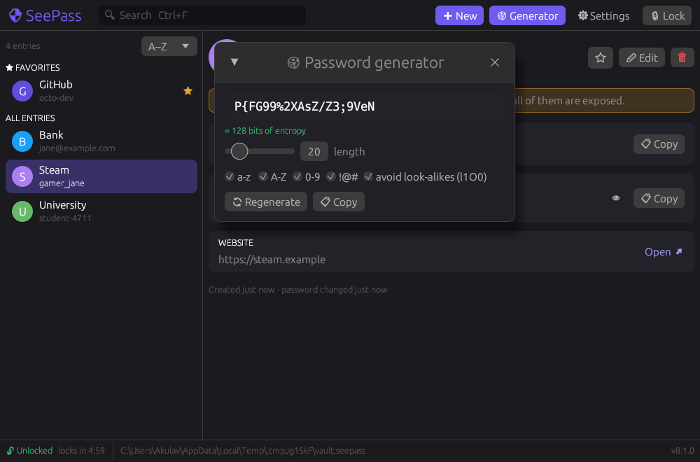

<p align="center"></p>

<h1 align="center">SeePass</h1>

<p align="center">
An offline password manager: one portable executable, one encrypted file, no cloud, no telemetry.
</p>

<p align="center">
<a href="https://github.com/Akulav/OfflinePasswordManager/actions/workflows/ci.yml"></a>
<a href="https://github.com/Akulav/OfflinePasswordManager/releases/latest"></a>
</p>

---

<p align="center">


</p>

SeePass keeps your logins in a single file on your own disk. The file is encrypted
with a key derived from your master password, and the app never touches the
network. Version 8 is a ground-up rewrite in Rust of the original C#/WinForms app.
See [what changed](CHANGELOG.md#800---2026-11-03).

## Features

- **Strong, modern crypto.** Argon2id key derivation and XChaCha20-Poly1305
  authenticated encryption. Every byte of the file, header included, is
  tamper-evident. [Details](docs/security.md).
- **Everything you'd expect.** Add, edit, search, sort and delete entries (title,
  username, password, website, notes), with favorites pinned to the top and
  10-second undo for deletes.
- **Password hygiene.** Warns when a password is reused across entries or hasn't
  changed in over a year.
- **Password generator** with character classes, look-alike filtering and an
  entropy readout, plus a zxcvbn **strength meter** with crack-time estimates.
- **Safe clipboard.** Copied secrets are wiped after 20 s and kept out of
  Windows clipboard history and cloud sync.
- **Auto-lock** after inactivity. Locking wipes the decrypted data and key from memory.
- **Backups.** Atomic saves, an automatic previous-version `.bak`, and encrypted
  backup export/merge with a separate password.
- **Migrates from SeePass 7.** Imports the old `C:\PasswordManager` folder or its
  `data.zip` export.
- **Portable.** No installer, no admin rights, no DLLs. Runs on Windows, Linux and macOS.
- Light and dark themes, full keyboard navigation, and screen-reader labels.

## Install

Download the latest build from the **[Releases page](https://github.com/Akulav/OfflinePasswordManager/releases/latest)**:

| Platform | File |
|---|---|
| Windows 10/11 (x64) | `seepass-<version>-windows-x64.exe` (or the `.zip`) |
| Linux (x64, glibc 2.35+) | `seepass-<version>-linux-x64.tar.gz` |
| macOS (Apple silicon) | `seepass-<version>-macos-arm64.tar.gz` |

Each release ships a `SHA256SUMS.txt`. Check your download against it:

```powershell
Get-FileHash .\seepass-8.0.0-windows-x64.exe
```

The binaries are not code-signed yet, so Windows SmartScreen and macOS Gatekeeper
will warn on first launch. On macOS, right-click the app and choose **Open**.

## Using SeePass

1. **First launch:** choose a master password. It cannot be recovered, so
   write it down somewhere safe. SeePass refuses easily guessed passwords.
2. **Add entries** with **New** (Ctrl+N). The 🎲 button fills in a generated password.
3. **Copy** a username or password from an entry's page. The clipboard clears itself.
4. **Lock** (Ctrl+L) when you step away, or let auto-lock do it. The status bar
   shows how long until it locks.

### Keyboard shortcuts

| Keys | Action | | Keys | Action |
|---|---|---|---|---|
| Ctrl+N | New entry | | Ctrl+C | Copy password of selected entry |
| Ctrl+F | Search (Esc clears) | | Ctrl+B | Copy username |
| ↑ / ↓ | Move through the list | | S | Toggle favorite |
| E or Enter | Edit selected entry | | Del | Delete (with undo) |
| Ctrl+S | Save while editing | | Ctrl+L | Lock |

<p align="center">


</p>

Your vault lives at:

| OS | Location |
|---|---|
| Windows | `%APPDATA%\SeePass\data\vault.seepass` |
| macOS | `~/Library/Application Support/SeePass/vault.seepass` |
| Linux | `~/.local/share/seepass/vault.seepass` |

Use `seepass --vault D:\path\to\other.seepass` to open a different file, or set
`SEEPASS_HOME` to move everything (vault and settings) to one folder, e.g. a USB stick.

### Coming from SeePass 7

Create your new vault, then open **Settings → Import from SeePass 7**. Enter
your old username, password and PIM. The old files are only read, never
modified. See [docs/migrating-from-7.md](docs/migrating-from-7.md).

## Building from source

You need a stable [Rust toolchain](https://rustup.rs). On Linux you also need the
GTK/X11 development packages:

```bash
sudo apt-get install libgtk-3-dev libxcb-render0-dev libxcb-shape0-dev libxcb-xfixes0-dev libxkbcommon-dev libssl-dev
```

```bash
cargo run --release
```

```bash
cargo test
```

To try the UI with fake data and leave your real vault alone:

```bash
SEEPASS_HOME=./demo cargo run --example demo_vault
```

```bash
SEEPASS_HOME=./demo SEEPASS_DEV_PASSWORD=demo-vault-correct-horse-battery cargo run
```

(`SEEPASS_DEV_PASSWORD` auto-unlocks **debug builds only**. Release builds don't contain that code.)

To regenerate the screenshots above from the headless UI tests:

```bash
SEEPASS_UI_SNAPSHOTS=target/ui cargo test --bin seepass -- --test-threads=1
```

`cargo build --no-default-features` leaves out the SeePass 7 importer and its
bundled SQLite.

## Documentation

- [Security design & threat model](docs/security.md): file format, what SeePass does and doesn't protect against
- [Architecture](docs/architecture.md): code layout and how the pieces fit
- [Releasing](docs/releasing.md): versioning and how a tag becomes a GitHub release
- [Migrating from SeePass 7](docs/migrating-from-7.md)
- [Changelog](CHANGELOG.md)

## License

See [LICENSE](LICENSE). Shield icon by [Freepik](https://www.flaticon.com/authors/freepik) from
[Flaticon](https://www.flaticon.com/).
